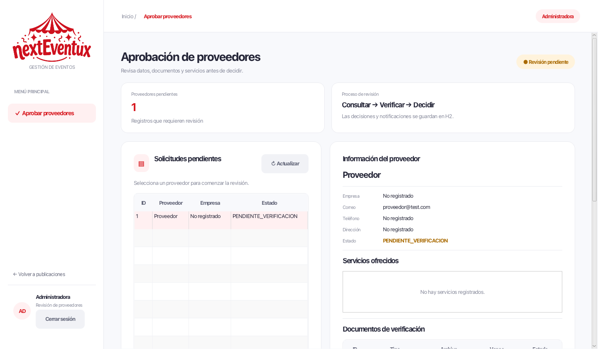

# Correcciones de acceso y sesión de CU28

Base: CU28-aprobar-proveedores, commit 340ea71. Este cambio conserva su flujo de
revisión documental, aprobación/rechazo y notificaciones.

## Problemas corregidos

- CU28 aprueba como VERIFICADO, pero el login solo permitía APROBADO. Se aceptan
  ambos estados para conservar registros anteriores. Pendientes, rechazados y
  usuarios inactivos siguen sin poder entrar como proveedores.
- La revisión administrativa solo comprobaba el rol al abrir la ventana. Ahora
  ServiceAdministracion recibe la sesión y comprueba, antes de cada consulta o
  modificación, que la cuenta siga activa, sea de tipo ADMINISTRADOR y conserve
  una asignación activa del rol ADMINISTRADOR en H2. No basta cambiar el tipo
  de una sesión en memoria. Un controlador sin sesión no puede operar.
- La ventana auxiliar se cierra al salir desde ella, al cerrar sesión desde la
  ventana principal o al cerrar la aplicación. El servicio conserva la referencia
  de sesión que se invalida al salir, de modo que tampoco funciona un controlador
  retenido. La ventana principal es su propietaria.
- El acceso a Aprobar proveedores está en la barra existente de Publicaciones.
  No se añade una barra global duplicada. La ventana administrativa muestra el
  logo compartido, el nombre de sesión y un botón real de cierre de sesión.

La corrección inicial de sesión no modificó el esquema H2 ni los estados de
proveedores existentes. CU26 no forma parte de esta corrección.

## Ajustes solicitados en revisión

Se integró main (402c8c9, incluye el PR #21 de CU12) conservando sus solicitudes,
propuestas y navegación, junto al acceso administrativo y cierre de sesión de
CU28. DatabaseConnection conserva el formato de main: solo agrega tres llamadas.

Las migraciones de CU28 se ejecutan después de 004_proveedores_cu12.sql:

- 005_proveedor_cu28.sql: motivo de rechazo.
- 006_cu28_documentos_notificaciones.sql: documentos y avisos de proveedores.
- 007_destinatario_notificacion_cu28.sql: restablece la restricción de destinatario.

003_cancelacion_eventos.sql vuelve a ser idéntica a main. La nueva migración 007
también corrige las bases que recibieron la restricción permisiva de CU28: exige
exactamente un destinatario (usuario o invitado). Primero valida la restricción
nueva, luego retira la anterior y renombra la nueva. Así no deja la tabla sin su
restricción anterior si existen avisos inválidos. No elimina ni asigna
destinatarios automáticamente: si encuentra avisos sin destinatario, la apertura
se detiene y hay que identificar su destinatario real antes de reintentar.

Las migraciones se pueden repetir y no se vuelven a cargar datos de ejemplo.
Las cuatro pruebas de MigracionesCU28Test comprueban base nueva, reapertura,
actualización desde la restricción anterior y conservación de un aviso inválido
con recuperación después de corregir su destinatario.

## Pruebas

La revisión inicial de sesión ejecutó 125 pruebas JUnit correctas. Después de
integrar main con CU12 y corregir las migraciones, se ejecutaron **159 pruebas
JUnit, todas correctas**, incluidas las cuatro nuevas de migración. También se
verificó en JavaFX que Solicitudes recibidas de CU12 sigue abriendo después del
login de un proveedor verificado.

Las 11 pruebas agregadas en la corrección inicial de sesión comprueban:

- aprobación con administrador real y posterior login del proveedor VERIFICADO;
- compatibilidad APROBADO y rechazo de estados/cuentas no habilitados;
- ausencia de sesión, organizador y proveedor sin permisos administrativos;
- cierre de sesión con un controlador retenido;
- suspensión de cuenta, retirada/desactivación del rol y cambio de tipo en H2;
- tipo de usuario manipulado solamente en memoria;
- reversión de aprobación si falla el registro de su notificación.

La comprobación nativa JavaFX recorre login, apertura de la ventana, logout desde
ambas ventanas, bloqueo del controlador anterior, login como proveedor verificado
y cierre de la ventana principal. Se usa H2 temporal sin modificar data/nexteventux.

Compilación con javac --release 17 y JUnit Platform Console 1.10.2. Con Maven
instalado puede ejecutarse mvn test. No se agregaron dependencias.

