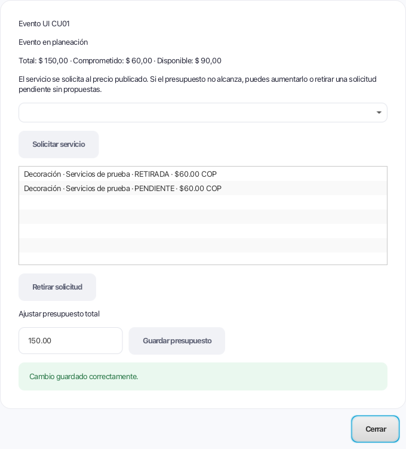
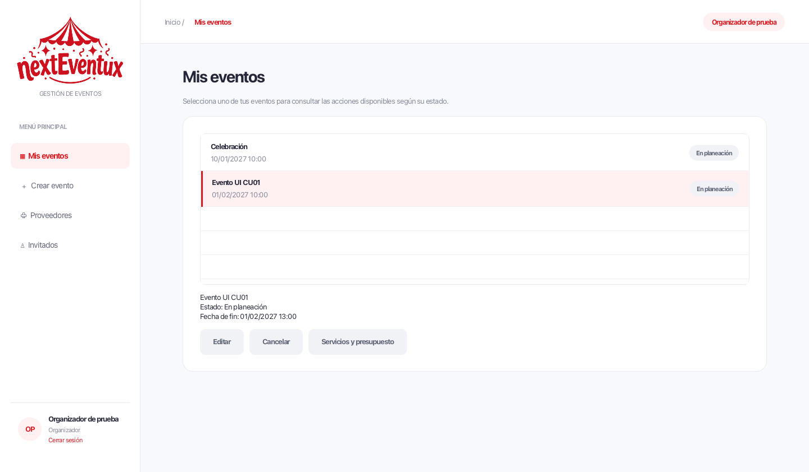

# CU01 — solicitudes y presupuesto

Esta entrega reúne los CU01–CU05 de Gestión de Eventos sobre main, incluido CU12
(PR #21). No incorpora la implementación administrativa del PR #15 de CU28.

## Uso

1. Iniciar sesión como organizador activo y crear un evento. Debe existir al menos
   un proveedor verificado; se conserva compatibilidad con el estado APROBADO.
2. Abrir **Servicios y presupuesto**, desde el formulario después de crear o desde
   **Mis eventos**. El organizador y el evento se toman de la sesión y selección.
3. Seleccionar un servicio por nombre y proveedor; solicitarlo al precio publicado.
   Se registran su necesidad para CU12, solicitud pendiente, costo y aviso interno
   al proveedor en una transacción.
4. Consultar total, comprometido y disponible. Si falta dinero, aumentar el total
   o retirar una solicitud pendiente que todavía no tenga propuestas.
5. El proveedor responde desde **Solicitudes recibidas** de CU12. El organizador
   puede seleccionar la propuesta desde **Propuestas recibidas**.

El presupuesto se ajusta en esta continuación de CU01. CU02 conserva la edición
de datos generales definida en su ficha. Después de salir de PLANEADO, el diálogo
de solicitudes es de consulta y el servicio rechaza modificaciones.

## Persistencia y reglas

- BigDecimal para importes y validación de hasta dos decimales.
- Solicitudes simultáneas bloquean el evento antes de comprobar el saldo.
- El precio se copia al solicitar; un cambio posterior del catálogo no altera ese
  compromiso. La contratación sustituye el costo de su solicitud, sin duplicarlo.
- Las contrataciones finalizadas conservan el importe comprometido. Las solicitudes
  rechazadas, canceladas y retiradas no comprometen presupuesto.
- El catálogo de CU12 aplica la misma comprobación para los eventos con presupuesto
  registrado y copia el costo de sus solicitudes. Su compatibilidad con registros
  históricos sin presupuesto se conserva.
- La migración 009 agrega costo_comprometido, sin inventar importes antiguos. Si una
  solicitud histórica activa carece de costo y no tiene contratación que lo sustituya,
  se informa que debe conciliarse; no se toma el precio actual del catálogo.
- Se serializa la inicialización del esquema para evitar ejecutar DDL simultáneo.
- Se retiraron de la migración 002 de proveedores los UPDATE que asignaban servicios
  por IDs de ejemplo en cada conexión. Esos vínculos están explícitos en seed.sql.
  La aplicación no carga el seed automáticamente ni modifica la base real al probar.

## Relación con CU02–CU05

| Caso | Comportamiento comprobado |
| --- | --- |
| CU02 | Edición precargada del evento propio en planeación; conserva sesión. |
| CU03 | Publicación del evento finalizado y revisión administrativa existente. |
| CU04 | Cancela solicitudes pendientes o en negociación y sus necesidades; avisa a proveedores, revoca invitaciones y libera recursos sin afectar reservas compartidas. |
| CU05 | Finaliza eventos CONFIRMADO cuya fecha de fin pasó; guarda fotografías, libera reservas y entrega galería interna con reintento. |

La migración de finalización es 008_finalizacion_eventos.sql. Los números 005–007
quedan disponibles para CU28; esta rama no incluye sus tablas administrativas.

CU12 selecciona propuestas, pero todavía no crea la contratación ni cambia Evento
a CONFIRMADO. Ese productor corresponde a la integración con CU13. No se introduce
un botón que fuerce ese estado. Las pruebas de cierre usan contrataciones y estados
de prueba explícitos: no demuestran que CU13 esté implementado. Tampoco se implementa
CU14 de reseñas, que no forma parte de los casos seleccionados para esta entrega.

## Validación

La rama de entrega compila con Java 17 y ejecuta **177 pruebas JUnit correctas**,
incluidas las 13 de SolicitudesEventoTest. La comprobación conjunta de CU01 y CU12
ejecuta 33 pruebas correctas. Se usaron javac y JUnit Platform Console 1.10.2 con
las dependencias existentes; no se añadieron bibliotecas. Con Maven instalado se
pueden ejecutar `mvn test` y `mvn javafx:run`.

SolicitudesEventoTest cubre autenticación y propiedad, proveedor suspendido, servicio
no disponible, falta de presupuesto, reversión si falla el aviso, importe conservado,
ajuste y retiro, bloqueo del retiro con propuesta, solicitud simultánea, contratación
sin doble conteo, cancelación y conexión con las respuestas de CU12. También verifica
el presupuesto al solicitar desde el catálogo.

Se comprobó JavaFX con H2 temporal: crear, solicitar, error por saldo insuficiente,
ajustar, retirar y acceder desde Mis eventos. Se recorrieron además CU02–CU05,
reintento de galería, cierre de sesión y aislamiento entre organizadores.

