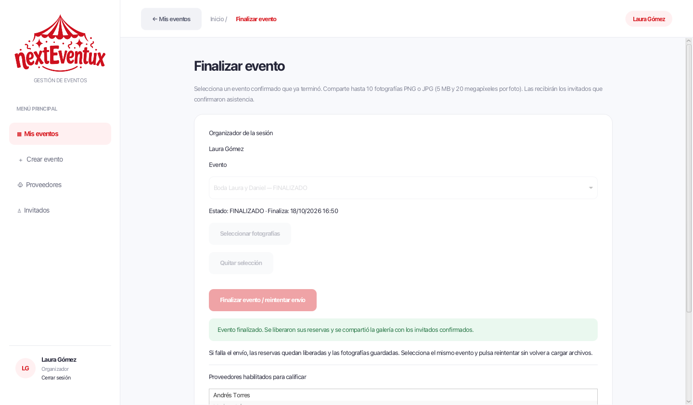
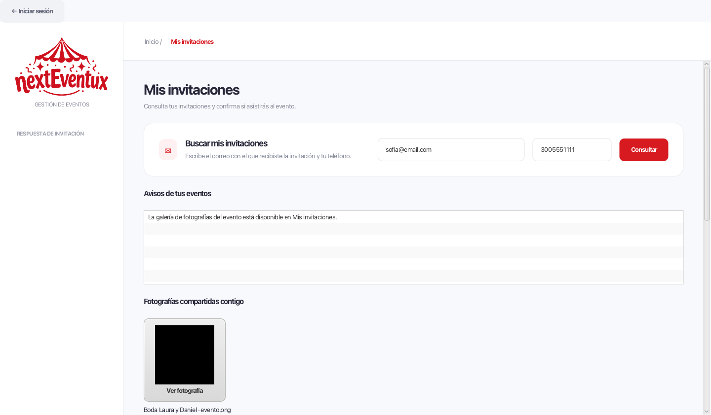
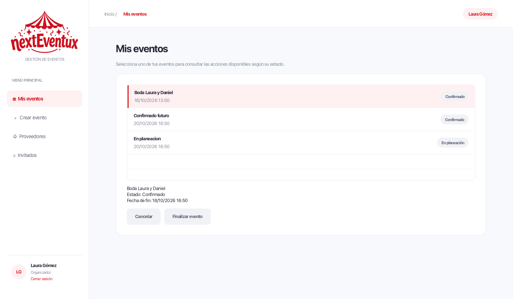

# CU05 — finalizar evento

Fuente: ficha CU-05, «Especificación Casos de Uso-37.pdf», Sara Alejandra Coy Calderón.
La cabecera de la plantilla dice CU-025, pero el campo Id Caso de Uso identifica CU-05.

## Comportamiento

- El organizador debe tener una sesión activa y solo puede finalizar eventos propios.
- Se exige estado CONFIRMADO y una fecha/hora de fin anterior al momento actual.
  Si aún no termina, el mensaje indica cuándo podrá finalizarlo.
- Se cargan entre 1 y 10 fotografías PNG/JPG, hasta 5 MB y 20 megapíxeles cada una.
  Se verifica el contenido de la imagen; la extensión no basta.
- Las fotografías se conservan en H2, no como rutas a archivos del computador.
- Se reutiliza la liberación de reservas de CU04, conservando recursos compartidos.
  Las contrataciones ACTIVA/CONFIRMADA del evento pasan a FINALIZADA para dejar
  de bloquear la disponibilidad; no se modifican pagos ni sanciones.
- Se seleccionan los invitados CONFIRMADO con invitación distinta de BORRADOR o
  REVOCADA. Se registra un aviso interno y se habilita su galería en Mis invitaciones.
  El acceso utiliza el correo y teléfono registrados, igual que el flujo de CU16.
- El evento pasa a FINALIZADO después de completar la entrega interna.
  No se revocan invitaciones ni se eliminan registros.

## Error de envío y reintento

La ficha tiene una contradicción: la postcondición de fracaso dice «sin cambios»,
pero E2 conserva las disponibilidades liberadas. Se acordó aplicar E2 y distribuir
la galería dentro de la aplicación.

Primera transacción: validar, guardar fotos y destinatarios, liberar reservas y
cerrar las contrataciones. Si falla esta etapa, se revierte todo.

Segunda transacción: crear los avisos, habilitar el acceso a la galería y cambiar
el evento a FINALIZADO. Si falla, se revierte solo esta etapa. El evento permanece
CONFIRMADO, con fotos guardadas y reservas liberadas. Se puede reintentar sin
volver a cargar archivos, incluso después de reabrir la pantalla. La galería no
es visible antes de completar esta etapa y no se duplican fotos ni avisos.

Mientras existe una finalización iniciada no se permite cancelar el mismo evento.
Una nueva finalización tras completar el proceso se rechaza.

## Interfaz e integración

La rama CU05-finalizar-evento parte de CU04-cancelar-evento e incorpora main.
Hasta integrar CU04, una comparación directa con main también incluye sus cambios.
Para revisar únicamente CU05 se puede comparar contra CU04-cancelar-evento.

`ViewFinalizacion(ControllerEventos, Runnable volver)` crea la pantalla.
El controlador debe recibir la sesión de la aplicación, igual que en CU02/CU04.
La vista incluye selección por nombre y estado, carga y vista previa de archivos,
mensajes de error, reintento y lista de proveedores habilitados para calificar.
Usa la hoja de estilos existente de eventos, sin dependencias nuevas.

La navegación compartida de main está integrada. Desde Mis eventos se selecciona
un evento confirmado cuya fecha/hora de fin ya transcurrió y se pulsa Finalizar
evento. El formulario precarga ese evento y no permite cambiarlo. La ruta es
dinámica, por lo que al regresar se actualiza la lista y sus acciones. Se usan
MenuCompartido para el menú, el logo, la barra superior y el cierre de sesión.
No se agrega una barra de navegación adicional.

Si la finalización tiene un envío pendiente, Mis eventos muestra Reintentar envío
de galería y oculta Cancelar; al reabrir el formulario se usan las fotos guardadas.
La galería está conectada a la consulta existente de Mis invitaciones desde login.
También se conserva el acceso a Mis avisos del proveedor desde Mis servicios.

La ficha remite la calificación a CU13, pero la tabla del proyecto asigna CU13 a
contratar servicio y CU14 a reseñas. Se expone `proveedoresParaCalificar` solo
tras finalizar, y la vista admite un callback opcional `IntConsumer` con el ID
interno del evento para abrir ese módulo. Sin callback, el botón está deshabilitado
con una explicación. No se implementa CU14, que está fuera del alcance seleccionado.

Esta rama no crea una transición artificial de PLANEADO a CONFIRMADO. La prueba
usa un evento confirmado como precondición; el flujo productor de ese estado debe
integrarse con el módulo responsable de las contrataciones CU12/CU13.

## Persistencia

Migración idempotente `008_finalizacion_eventos.sql`:

- `Finalizacion_evento`: inicio del proceso y estado de entrega.
- `Fotografia_evento`: nombre y bytes de cada foto.
- `Entrega_galeria`: destinatarios seleccionados al iniciar el cierre.

No se agregan bibliotecas ni se reemplaza la configuración H2 existente.

## Validación

`FinalizacionTest` cubre éxito y persistencia, fecha futura y hora exacta de fin,
estados inválidos, sesión y propiedad, imágenes inválidas y límites de carga,
reversión por error de liberación, error de envío con reintento sin duplicados,
reservas compartidas, reservas sin vínculo, ausencia de confirmados, acceso con
correo/teléfono, galerías todavía no entregadas e invitaciones revocadas.

Las pruebas de CU04 siguen comprobando la liberación compartida. La comprobación
nativa JavaFX ejecuta el botón de finalización y consulta la galería como invitado
con H2 temporal; conserva capturas en `docs/evidencias/cu05-*.png`. La selección
del archivo mediante el diálogo nativo requiere una comprobación manual adicional.

La comprobación usa datos de prueba; no modifica `data/nexteventux`.

Resultado: 134 pruebas JUnit ejecutadas correctamente (15 de CU05), compilando
con `javac --release 17` y ejecutando JUnit Platform Console 1.10.2. No hay Maven
instalado en este equipo. En un equipo con Maven puede ejecutarse `mvn test`.
Después de agregar el indicador de envío pendiente se repitieron las 15 pruebas
de CU05, todas correctas. También se comprobó en JavaFX el error de envío,
la reapertura de la pantalla y el reintento sin cargar fotografías nuevamente.

## Validación de la navegación compartida

Después de incorporar main se ejecutaron nuevamente las 134 pruebas JUnit, todas
correctas. Se recorrió la aplicación JavaFX real con H2 temporal: login, lista de
eventos propios, CU02 precargado, bloqueo de finalización futura, apertura de CU05,
error de entrega, regreso y reintento con fotos guardadas, actualización de estado,
CU03 precargado, CU04 precargado y cancelación, cierre de sesión y consulta pública
de la galería. Se comprobaron además los avisos del proveedor, el ingreso del
administrador y el aislamiento entre dos cuentas de organizador.

## Entrega conjunta con CU01–CU04

La rama de entrega se basa en main con CU12 integrado y conserva estos flujos sin
incorporar la implementación administrativa de CU28. La validación actual y las
limitaciones de contratación se documentan en [CU01 y presupuesto](cu01-solicitudes-presupuesto.md).
