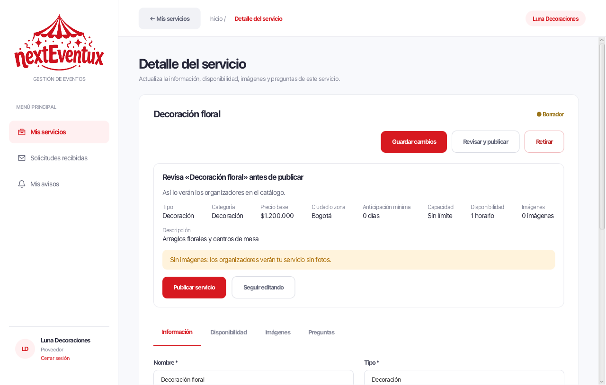
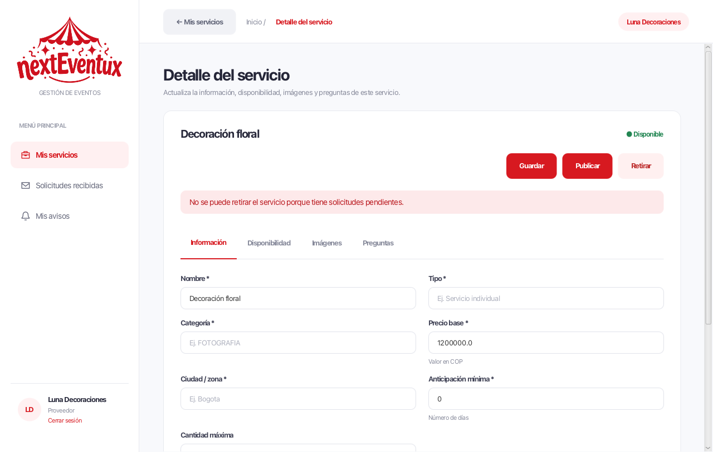

# CU-11 — publicación de servicios

Fuente: ficha CU-11 de «Especificación Casos de Uso.xlsx». El proveedor
registra su servicio, define su disponibilidad y lo publica para que los
organizadores lo contraten.

## Qué hace cada pantalla

### Proveedor — Detalle del servicio

- Los avisos (guardado, publicado, retirado, errores) aparecen dentro de la
  pantalla, justo debajo de los botones. No hay ventanas emergentes.
- Acciones del encabezado: **Guardar cambios** (principal), **Revisar y
  publicar** y **Retirar**.
- **Revisar y publicar** muestra un resumen con tipo, ciudad, capacidad,
  anticipación y horarios, y avisa de lo que falta. El botón **Publicar
  servicio** solo se habilita cuando no hay bloqueos.
- En la pestaña **Disponibilidad** cada horario tiene su propio botón
  **Eliminar**; ya no hay que seleccionar una fila primero.

## Reglas de la ficha que cubre

| Regla de la ficha | Dónde se cumple |
| --- | --- |
| Revisar la publicación antes de publicar | `RevisionPublicacion` y `PresentacionServicio.revisar` |
| Publicar exige al menos un horario | `ServiceProveedores.publicarServicio` |
| Retirar con solicitudes pendientes (E1) | `ServiceProveedores.retirarServicio` |
| Proveedor verificado | `ServiceAutenticacion` impide iniciar sesión si el proveedor no está aprobado o verificado |

## Organización del código

`ViewDetalleServicioProveedor` ya es una pantalla grande, así que las piezas
nuevas viven aparte en `views/servicios/`:

- `PresentacionServicio`: decide qué bloquea la publicación y qué solo
  advierte. No usa JavaFX, por eso se prueba sin abrir una ventana.
- `RevisionPublicacion`: resumen y botón de publicar.
