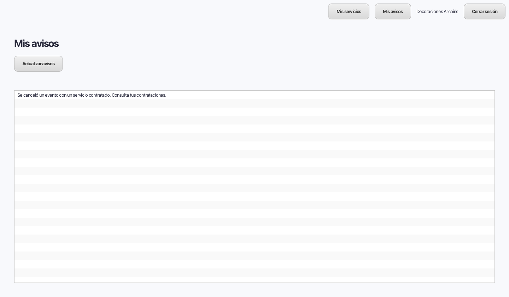
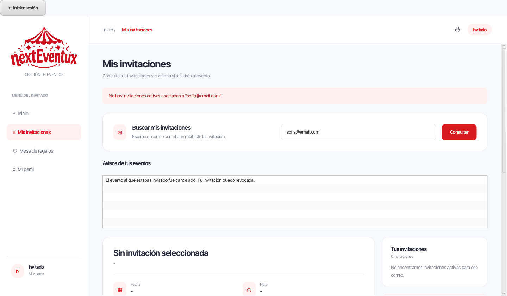

# Integración de cancelaciones con proveedores e invitados

La rama CU04 integra `CU11-gestionar-servicio-integracion` (ab53dce) y el flujo
existente de `CU16-gestionar-respuesta-invitacion`. No modifica sus ramas remotas.
CU17 ya forma parte de la base de CU11 y de main. La integración requiere revisión
de los responsables de Proveedores e Invitados antes de fusionarse.

## Reservas de servicios

CU11 almacena la disponibilidad en `Disponibilidad_Servicio` y comprueba los
horarios contratados mediante `Solicitud_Ejecucion.id_servicio`,
`Contratacion.fecha_servicio`, `hora_inicio` y `hora_fin`. Considera activas las
contrataciones ACTIVA y CONFIRMADA; CU04 ahora contempla ambos estados.

El productor de la contratación debe guardar esos datos y puede guardar además
`Contratacion.id_disponibilidad`. Si falta este último vínculo, CU04 lo completa
exclusivamente cuando existe una disponibilidad con el mismo servicio, fecha y
horas exactas. El índice único de CU11 garantiza una sola coincidencia. Se valida
además que el servicio pertenezca al proveedor de la solicitud y que la solicitud
pertenezca al evento. Un vínculo directo incompatible también se rechaza.

La resolución del vínculo, liberación, cancelación y avisos ocurren dentro de la
misma transacción. Si falta una reserva o hay una incoherencia, no se guarda nada.
Una contratación ACTIVA o CONFIRMADA de otro evento mantiene la reserva ocupada,
tanto si tiene el vínculo directo como si coincide exactamente por servicio,
fecha y horas. Cancelar el último compromiso libera la disponibilidad sin cambiar
los contratos de otros eventos. Una contratación de otra fecha no retiene esa reserva.

Las migraciones no rellenan vínculos basándose en identificadores de ejemplos.
Los servicios de las solicitudes de demostración se especifican solo en seed.sql.

## Reserva del lugar

El flujo responsable de reservar debe guardar `Evento.id_lugar` como clave real.
CU04 no deduce esa reserva del texto de ubicación. Si una invitación utiliza un
lugar reservado sin un vínculo coherente con el evento, la cancelación se bloquea.

No se encontró en las ramas consultadas el código que registra la contratación
ni la reserva del lugar. Las pruebas construyen esas contrataciones como fixtures;
no equivalen a ejecutar CU12/CU13 de Proveedores. Falta identificar e integrar
ese productor y verificar el recorrido desde la contratación/reserva hasta la cancelación.

## Lectura de avisos

- Proveedores: después del login, **Mis avisos** consulta Notificacion_interna por
  id_usuario. Comprueba el vínculo Usuario/Proveedor, sus estados y el rol antes
  de cada lectura. Cerrar sesión o suspender al proveedor impide consultar.
- Invitados: desde el login, **Consultar mis invitaciones** abre la pantalla de
  CU16 existente. La consulta por correo muestra separadamente los avisos, incluso
  cuando la invitación ya fue revocada. La invitación revocada no permite responder.
  Cambiar el correo limpia los resultados anteriores.

La consulta por correo de CU16 no autentica la propiedad de ese correo. Se conserva
el mecanismo existente; no se presenta como un login de invitado. Si el equipo
requiere verificar identidad mediante cuenta, enlace o código, esa integración
sigue pendiente de su definición. No se envían correos ni mensajes externos.

## Verificación

Se prueban los repositorios reales de disponibilidad de CU11 y la consulta de CU16,
la cancelación de contrataciones CONFIRMADA, el vínculo exacto de horarios, la
reversión de vínculos si falla otra reserva, la conservación de reservas compartidas,
el aislamiento y revocación de acceso del proveedor y los avisos tras revocación.
Las pruebas usan H2 temporal y no modifican la base de la aplicación.

La comprobación JavaFX ejecuta cancelación con fallo simulado y reintento,
consulta del aviso con el login del proveedor y consulta del invitado después de
revocar la invitación. También comprueba el cambio de cuenta/correo.

## Compatibilidad con main

CU04 incorpora las conciliaciones de CU02 y CU03 con main. Conserva el catálogo,
la navegación a Invitados, la gestión de servicios y las bandejas de avisos. El
login mantiene el manejo de errores de main y las conexiones aisladas de pruebas.
