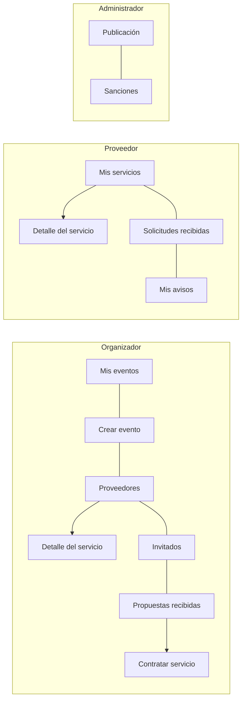

# Navegación e interfaz compartidas

Las vistas autenticadas se muestran dentro de `NextEventuxApp` y las rutas se
registran en `Navegacion`. Cada pantalla principal se registra con
`registrar(...)`, por lo que su instancia y estado se conservan al volver.
Para cambiar el elemento mostrado en una ruta registrada, invalide esa pantalla
con `navegacion.invalidar(...)` antes de navegar. Use `registrarDinamica(...)`
solo si la pantalla debe crearse de nuevo en cada visita.

En una vista autenticada:

- Construya el menú con `MenuCompartido.crear(...)`, indicando el rol, la
  página activa y las acciones recibidas por constructor.
- Use `MenuCompartido.crearBarraSuperior(sesion, titulo)` para mostrar la
  misma ruta, altura y nombre de sesión.
- Use `MenuCompartido.crearLogo()` para reutilizar
  `/images/logo-nexteventux.png`.
- No cree opciones de menú sin una acción. Añada la ruta y su fábrica a
  `Navegacion.Pantalla` y al registro de rutas del rol correspondiente en
  `NextEventuxApp`; conecte las acciones con `navegacion.ir(...)`.
- Pase `SesionUsuario` a todos los componentes que muestran nombre, iniciales
  o rol. El cierre de sesión debe delegar en la acción común de la aplicación.

«Proveedores» es la ruta de catálogo del organizador. «Mis servicios» es la
ruta de gestión del proveedor; deben registrarse y navegarse por separado.

## Menú lateral por rol

El menú lo construye siempre `MenuCompartido.crear(...)`; cada rol ve estas
opciones, en todas sus pantallas:

| Rol | Opciones |
| --- | --- |
| Organizador | Mis eventos, Crear evento, Proveedores, Invitados, Propuestas recibidas |
| Proveedor | Mis servicios, Solicitudes recibidas, Mis avisos |
| Administrador | Publicación, Sanciones |

Todas las pantallas del proveedor (lista de servicios, detalle del servicio,
solicitudes y avisos) reciben las tres acciones del menú, así que
«Solicitudes recibidas» y «Mis avisos» se ven también dentro del detalle de un
servicio. Si se añade una pantalla nueva, debe pasar las tres.

Las líneas unen opciones del mismo menú; las flechas son pantallas a las que se
llega desde una opción.

## Contratación del servicio (CU-13)

La contratación es una pantalla más de la aplicación (`CONTRATAR_SERVICIO`,
registrada con `registrarDinamica(...)`) y no una ventana emergente. Se llega
desde «Propuestas recibidas» con el botón «Contratar servicio» de una propuesta
en estado `SELECCIONADA`; `NextEventuxApp` guarda la propuesta elegida y
navega a la pantalla.

Al abrirla, `ViewContratarServicio` consulta sola el resumen, la
disponibilidad del proveedor y el presupuesto del evento. No hay botones de
verificación. Muestra el servicio, el proveedor, el precio acordado, el
presupuesto disponible antes y después de contratar y el mensaje
«Disponibilidad verificada para el evento».

- «Confirmar contratación» es la única acción principal y solo se habilita si
  `PresentacionContratacion.puedeConfirmar(...)` es verdadero. Si no, la
  pantalla indica el motivo.
- Confirmar no pide una segunda confirmación. `contratar()` vuelve a validar
  dentro de su transacción; si algo cambió, el error aparece en la misma
  pantalla y se actualizan las verificaciones.
- El resultado se muestra en el mismo panel con el botón «Ver propuestas».
- Salir antes de confirmar («Volver a propuestas» o el menú) no reserva nada.

Los formatos de valores y fechas están en `FormatoUi` (`$1.500.000`,
`20 nov. 2026`). Los estilos comunes (`btn-primary`, `btn-secondary`,
`btn-ghost`, `btn-danger`, chips de estado y banners) están en
`styles/proveedores.css`.
